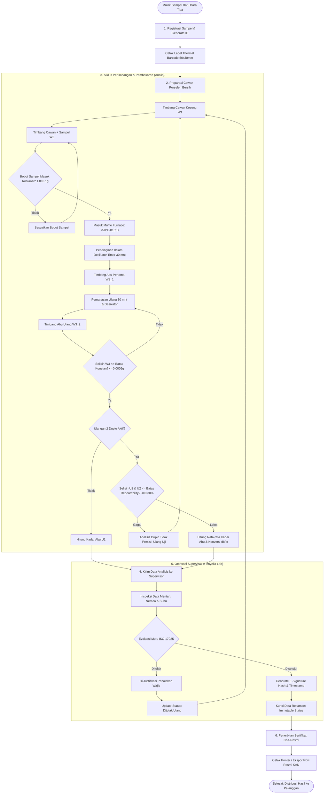
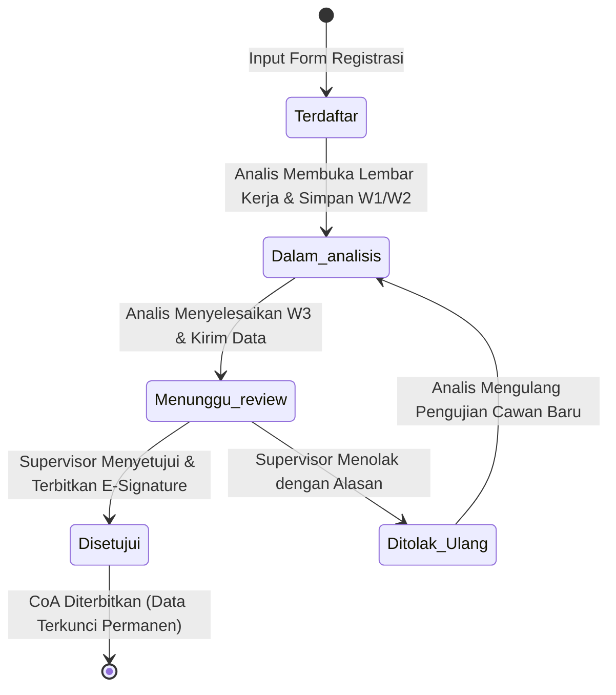
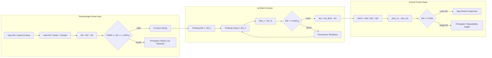
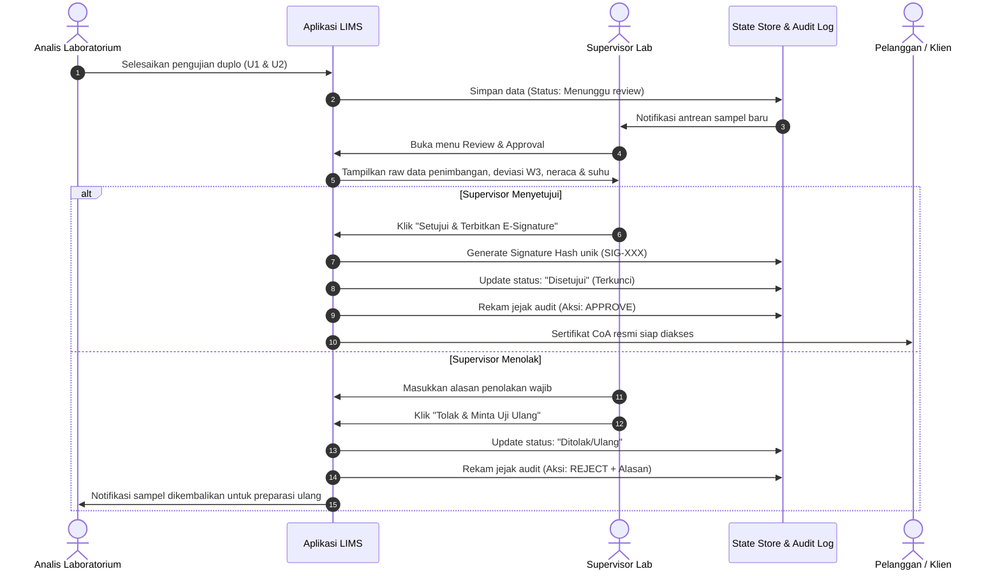
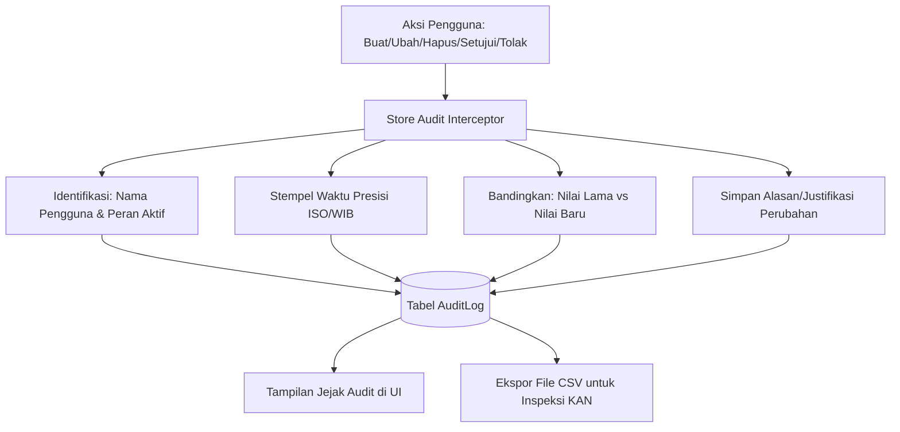
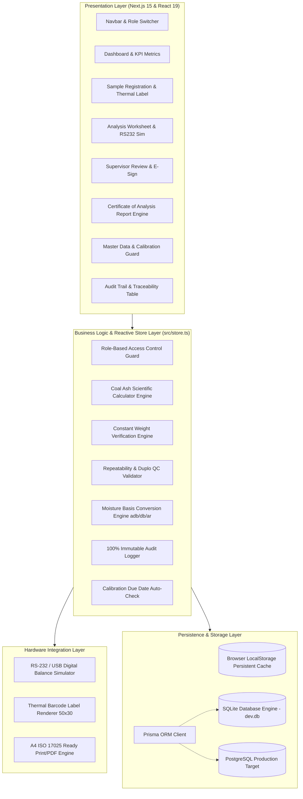

# DOKUMENTASI ARSITEKTUR, PRD, FLOW PROSES & ERD
## Aplikasi Analisis Kadar Abu Batu Bara (*Coal Ash Testing LIMS*)
**Standar Kepatuhan: ISO/IEC 17025:2017 | ASTM D3174 | ISO 1171 | SNI 06-3730**  
**Versi Dokumen: 1.0 (Production-Ready Architecture)**  
**Tanggal Rilis: Oktober 2026**

---

## DAFTAR ISI
1. [BAB I: Ringkasan Eksekutif & Latar Belakang](#bab-i-ringkasan-eksekutif--latar-belakang)
2. [BAB II: Product Requirements Document (PRD)](#bab-ii-product-requirements-document-prd)
   - 2.1 Tujuan & Sasaran Produk
   - 2.2 Persona & Matriks Hak Akses (RBAC)
   - 2.3 Daftar Kebutuhan Fungsional (FR-001 s/d FR-123)
   - 2.4 Kebutuhan Non-Fungsional (NFR)
   - 2.5 Aturan Bisnis & Rumus Matematis Uji Mutu
3. [BAB III: Flow Proses Sistem & Bisnis](#bab-iii-flow-proses-sistem--bisnis)
   - 3.1 Alur Kerja End-to-End Pengujian Laboratorium
   - 3.2 Diagram Transisi Status Sampel (*State Machine*)
   - 3.3 Flowchart Penimbangan Bertingkat & QC (*Constant Weight & Repeatability*)
   - 3.4 Flowchart Review & Persetujuan Supervisor (*E-Signature Workflow*)
   - 3.5 Alur Jejak Audit & Ketertelusuran (*Audit Trail Capture*)
4. [BAB IV: Entity-Relationship Diagram (ERD) & Kamus Data](#bab-iv-entity-relationship-diagram-erd--kamus-data)
   - 4.1 Diagram ERD Relasional (Mermaid)
   - 4.2 Kamus Data & Spesifikasi Tabel (Prisma ORM & SQLite)
   - 4.3 Integritas Referensial & Kardinalitas
5. [BAB V: Arsitektur Aplikasi & Rekayasa Perangkat Lunak](#bab-v-arsitektur-aplikasi--rekayasa-perangkat-lunak)
   - 5.1 Arsitektur Sistem Bertingkat (*High-Level Multi-Tier Architecture*)
   - 5.2 Pola Komponen & Manajemen State (*Reactive Store Pattern*)
   - 5.3 Lapisan Integrasi Instrumen Lab (Simulasi Hardware RS-232 / USB)
   - 5.4 Mesin Pelaporan & Tata Letak Cetak ISO 17025 (CoA)
   - 5.5 Struktur Direktori & Modul Aplikasi
6. [BAB VI: Panduan Operasional & Rencana Pengembangan Lanjutan](#bab-vi-panduan-operasional--rencana-pengembangan-lanjutan)

---

# BAB I: Ringkasan Eksekutif & Latar Belakang

### 1.1 Latar Belakang
Pengujian kadar abu (*ash content*) batu bara merupakan salah satu parameter paling krusial dalam industri energi, pertambangan, dan metalurgi. Kadar abu menentukan efisiensi pembakaran di PLTU, potensi terbentuknya kerak/slagging pada boiler, serta penentu nilai komersial batubara dalam transaksi ekspor maupun domestik.

Sebelum sistem ini dibangun, banyak laboratorium masih mengandalkan pencatatan lembar kerja manual di kertas (*paper worksheet*) atau spreadsheet Excel yang memiliki kelemahan kritis:
1. **Risiko *Human Error***: Kesalahan kalkulasi matematis bobot sampel, selisih berat konstan, dan konversi basis (*air-dried*, *dry basis*, *as-received*).
2. **Ketiadaan Jejak Audit (*Audit Trail*)**: Data penimbangan dapat diubah tanpa riwayat siapa yang mengubah, kapan, dan mengapa, yang melanggar klausul 7.5 & 8.4 ISO/IEC 17025.
3. **Peralatan Kedaluwarsa**: Neraca analitik atau tungku muffle (*furnace*) yang telah lewat jatuh tempo kalibrasinya kerap tetap digunakan tanpa peringatan otomatis.
4. **Keterlambatan Penerbitan Sertifikat (CoA)**: Alur persetujuan fisik dari Analis ke Penyelia membutuhkan waktu lama dan rawan manipulasi.

### 1.2 Solusi: Coal Ash Testing LIMS
Aplikasi **Coal Ash Testing LIMS** (`coal-ash-app`) dirancang dan diimplementasikan secara komprehensif untuk mendigitalisasi 100% siklus hidup pengujian kadar abu batubara sesuai standar internasional **ASTM D3174-12**, **ISO 1171:2010**, dan standar nasional **SNI 06-3730-1995**, dengan kepatuhan penuh terhadap tata kelola mutu laboratorium terakreditasi KAN/ISO 17025.

---

# BAB II: Product Requirements Document (PRD)

## 2.1 Tujuan & Sasaran Produk
* **Akurasi Data 99.99%**: Mengeliminasi kesalahan perhitungan dengan mesin hitung otomatis berpresisi 4 desimal (0.0001 g).
* **Kepatuhan ISO/IEC 17025**: Menjamin ketertelusuran pengukuran (*measurement traceability*), kontrol alat kalibrasi aktif, dan perekaman jejak audit permanen.
* **Efisiensi Waktu Pengujian**: Mempercepat proses input, validasi duplikat duplo otomatis, dan penerbitan *Certificate of Analysis* (CoA) resmi dalam hitungan detik setelah persetujuan supervisor.
* **Integritas & Anti-Repudiasi**: Mengamankan pengesahan hasil uji menggunakan tanda tangan elektronik unik (*E-Signature Hash*) dan sistem status terkunci (*immutable*).

---

## 2.2 Persona & Matriks Hak Akses (RBAC)

Aplikasi menerapkan pemisahan tugas ketat (*Segregation of Duties - SoD*):

| Peran (*Role*) | Deskripsi Tanggung Jawab | Hak Akses Utama |
|---|---|---|
| **Analis** (*Laboran*) | Personel operasional laboratorium yang menerima sampel, melakukan preparasi cawan, penimbangan neraca, pembakaran furnace, dan pencatatan duplo. | • Mendaftarkan sampel baru & cetak label barcode<br>• Mengisi lembar kerja penimbangan W1, W2, W3<br>• Mengaktifkan timer desikator pendingin<br>• Mengirim data ke antrean review supervisor |
| **Supervisor** (*Penyelia Lab*) | Manajer teknis laboratorium yang mengevaluasi kepatuhan SOP, menganalisis data mentah penimbangan, repeatability duplo, dan mengesahkan hasil uji. | • Memeriksa detail kalkulasi & deviasi bobot<br>• Menyetujui (*Approve*) dengan tanda tangan digital<br>• Menolak (*Reject*) dengan alasan audit wajib<br>• Mengakses rekaman Audit Trail penuh |
| **Admin** (*Sistem Lab*) | Administrator TI dan koordinator kendali mutu instrumen lab. | • Mengelola akun pengguna (tambah, reset sandi, status aktif)<br>• Mengatur Master Data (Metode, Neraca, Furnace, Cawan)<br>• Memantau jadwal kalibrasi alat<br>• Ekspor riwayat audit menyeluruh |
| **Pelanggan** (*Klien Eksternal*) | Pihak pembeli batu bara, surveyor independen, atau bagian logistik PLTU. | • Akses *read-only* melihat sertifikat CoA resmi sampel yang telah disetujui<br>• Mencetak atau mengunduh CoA berformat PDF resmi |

### Matriks Otorisasi Fitur:
| Modul / Tindakan | Analis | Supervisor | Admin | Pelanggan |
|---|:---:|:---:|:---:|:---:|
| Registrasi Sampel Baru | ✅ | ❌ | ✅ | ❌ |
| Cetak Label Barcode Thermal | ✅ | ✅ | ✅ | ❌ |
| Input Penimbangan W1/W2/W3 | ✅ | ❌ | ✅ | ❌ |
| Simulasi RS232 Neraca | ✅ | ❌ | ✅ | ❌ |
| Review & Pengesahan Hasil (Approve) | ❌ | ✅ | ✅ | ❌ |
| Penolakan Hasil Uji (Reject) | ❌ | ✅ | ✅ | ❌ |
| Master Data Metode & Kalibrasi Alat | ❌ | ❌ | ✅ | ❌ |
| Manajemen Akun Pengguna | ❌ | ❌ | ✅ | ❌ |
| Akses Menu Audit Trail | ❌ | ✅ | ✅ | ❌ |
| Lihat & Cetak Sertifikat CoA Resmi | ✅ | ✅ | ✅ | ✅ |

---

## 2.3 Daftar Kebutuhan Fungsional (Functional Requirements)

| Kode FR | Modul | Deskripsi Kebutuhan |
|---|---|---|
| **FR-001** | Sesi & Auth | Sistem menyediakan otentikasi login multi-user dengan enkripsi sandi dan verifikasi peran. |
| **FR-002** | Sesi & Auth | Sistem mendukung pengalihan peran cepat (*Quick Role Switcher*) untuk keperluan simulasi operasional multi-personel. |
| **FR-003** | Profil Pengguna | Pengguna dapat memperbarui nama, email, telepon, jabatan, dan kata sandi mandiri. |
| **FR-010** | Master Data | Admin dapat mengonfigurasi metode analisis (ASTM D3174, ISO 1171, SNI) beserta parameter suhu, durasi, target bobot, dan toleransi. |
| **FR-011** | Master Data | Admin dapat mendaftarkan instrumen neraca analitik dengan resolusi 0.0001 g, tanggal kalibrasi, dan tanggal jatuh tempo. |
| **FR-012** | Master Data | Admin dapat mendaftarkan tungku furnace pembakaran (kapasitas cawan, jadwal tera). |
| **FR-013** | Master Data | Admin/Analis dapat mengelola inventaris cawan silika/porselen beserta riwayat bobot kosong terakhir. |
| **FR-015** | Validasi Alat | Sistem secara otomatis mendeteksi neraca yang telah melewati jatuh tempo kalibrasi, memunculkan alert di dasbor, dan memblokir penggunaannya untuk penimbangan resmi. |
| **FR-020** | Registrasi Sampel | Sistem menerbitkan ID sampel unik otomatis dengan format standar `BB-YYMMDD-NNN` (e.g. `BB-261012-005`). |
| **FR-021** | Registrasi Sampel | Analis mencatat sumber sampel (Stockpile, Kapal, Tongkang, Pit), jenis batubara, tanggal terima, dan basis pelaporan (`adb`, `db`, `ar`). |
| **FR-022** | Registrasi Sampel | Analis dapat memasukkan kadar lengas (*moisture* adb & ar) untuk keperluan konversi basis. |
| **FR-023** | Registrasi Sampel | Sistem menyediakan pratinjau dan cetak label barcode thermal ukuran 50x30 mm untuk ditempel pada wadah sampel fisik. |
| **FR-024** | Registrasi Sampel | Sistem menyediakan fitur ekspor daftar sampel ke berkas CSV. |
| **FR-030** | Penimbangan W1 | Analis menginput bobot cawan kosong ($W_1$) dengan ketelitian 4 angka desimal. |
| **FR-031** | Penimbangan W2 | Analis menginput bobot cawan + sampel batubara ($W_2$). |
| **FR-032** | Validasi Bobot | Sistem menghitung bobot sampel $W_s = W_2 - W_1$ secara *real-time* dan memberikan indikator visual apakah masuk rentang target metode (1.0000 ± 0.1000 g). |
| **FR-040** | Pembacaan Digital | Sistem menyediakan tombol simulasi pembacaan langsung dari port RS232/USB neraca dengan status stabil. |
| **FR-050** | Log Pembakaran | Analis mencatat jam masuk furnace, jam keluar furnace, dan suhu aktual (°C). |
| **FR-051** | Timer Desikator | Sistem menyediakan penghitung waktu mundur pendinginan cawan dalam desikator (standar 20-30 menit) dengan notifikasi pop-up saat selesai. |
| **FR-060** | Uji Berat Konstan | Analis mencatat penimbangan abu pertama ($W_{3,1}$) dan pemanasan ulang kedua ($W_{3,2}$). Sistem mengecek apakah selisih $|\Delta W_3| \le \text{batas metode}$ (e.g. $\le 0.0005$ g). |
| **FR-070** | Ulangan Duplo | Sistem mendukung pengujian duplikat (Ulangan 1 dan Ulangan 2) dalam satu berkas analisis. |
| **FR-071** | QC Repeatability | Sistem memvalidasi apakah selisih hasil abu U1 dan U2 memenuhi batas presisi metode ($|\text{Abu}_1 - \text{Abu}_2| \le 0.30\%$). |
| **FR-080** | Konversi Basis | Sistem secara otomatis mengonversi kadar abu ke basis *Dry Basis* ($db$) dan *As Received* ($ar$). |
| **FR-090** | Supervisor Review | Supervisor dapat meninjau seluruh data mentah penimbangan, deviasi duplikat, dan kurva toleransi. |
| **FR-091** | Otorisasi E-Sign | Supervisor mengesahkan hasil uji dengan menerbitkan tanda tangan elektronik (*Signature Hash*) berstempel waktu. |
| **FR-092** | Penolakan Uji | Supervisor dapat menolak hasil uji dengan mencantumkan alasan penolakan wajib, yang mengembalikan status sampel ke `Ditolak/Ulang`. |
| **FR-100** | Sertifikat CoA | Sistem menyusun *Certificate of Analysis* (CoA) standar ISO 17025 berformat kop surat resmi PT Mineral Analitika Laboratorium. |
| **FR-101** | Cetak & Ekspor PDF | Halaman CoA dioptimasi khusus untuk cetak printer lab maupun ekspor dokumen PDF via fitur cetak peramban. |
| **FR-110** | Dasbor Analitik | Menampilkan KPI total sampel, antrean penimbangan, status review, persentase kelulusan QC, dan daftar uji terbaru. |
| **FR-120** | Jejak Audit 100% | Setiap aksi `CREATE`, `UPDATE`, `DELETE`, `APPROVE`, `REJECT` otomatis tercatat permanen di tabel `AuditLog` dengan nilai lama, nilai baru, aktor, peran, dan alasan. |
| **FR-121** | Ekspor Audit | Jejak audit dapat difilter berdasarkan entitas dan diekspor ke CSV untuk audit kepatuhan eksternal KAN. |

---

## 2.4 Kebutuhan Non-Fungsional (Non-Functional Requirements)

1. **Integritas Data & Traceability (ISO 17025)**:
   - Data penimbangan yang telah disetujui terkunci secara *immutable* (tidak dapat diedit maupun dihapus oleh siapapun).
   - Seluruh perubahan data mentah wajib merekam alasan pembaruan pada *Audit Trail*.
2. **Kinerja & Responsivitas UI**:
   - Waktu respons perhitungan matematis penimbangan $< 50\text{ ms}$ (dilakukan langsung pada *client-side reactive engine*).
   - Render antarmuka berbasis React 19 dengan transisi mulus dan *glassmorphism* modern.
3. **Kompatibilitas Layar & Pencetakan**:
   - Tampilan responsif mendukung layar desktop laboratorium (1920x1080), tablet preparasi (1024x768), dan ponsel pintar.
   - Tata letak cetak (*Print CSS*) khusus menyembunyikan navigasi, bilah samping (*sidebar*), tombol aksi, dan mencetak dokumen pada rasio kertas A4 presisi.
4. **Ketersediaan Offline / Jaringan Lokal**:
   - Dapat dioperasikan pada intranet tertutup laboratorium (*air-gapped LAN*) tanpa ketergantungan API pihak ketiga eksternal.

---

## 2.5 Aturan Bisnis & Rumus Matematis Uji Mutu

### 1. Perhitungan Bobot Sampel ($W_s$):
$$W_s = W_2 - W_1$$
* **Aturan**: Bobot sampel wajib bernilai positif dan memenuhi toleransi metode:
$$(W_{\text{target}} - \text{Toleransi}) \le W_s \le (W_{\text{target}} + \text{Toleransi})$$
* Untuk ASTM D3174: Target $= 1.0000\text{ g}$, Toleransi $= \pm 0.1000\text{ g}$ $\rightarrow$ Rentang valid: $0.9000\text{ g}$ s/d $1.1000\text{ g}$.

### 2. Perhitungan Bobot Abu ($W_a$):
$$W_a = W_3 - W_1$$
Di mana $W_3$ adalah bobot akhir cawan beserta abu setelah uji berat konstan.

### 3. Uji Berat Konstan (*Constant Weight Verification*):
Cawan dipanaskan kembali pada suhu uji selama 30-60 menit tambahan, didinginkan dalam desikator, dan ditimbang ulang ($W_{3,2}$):
$$|\Delta W_3| = |W_{3,1} - W_{3,2}| \le \text{Batas Berat Konstan}$$
* ASTM D3174: $|\Delta W_3| \le 0.0005\text{ g}$ (0.5 mg)
* ISO 1171: $|\Delta W_3| \le 0.0002\text{ g}$ (0.2 mg)

### 4. Perhitungan Kadar Abu Basis Kering Udara ($Ash_{\text{adb}}$ %):
$$Ash_{\text{adb}} = \left( \frac{W_a}{W_s} \right) \times 100\%$$
Presisi pembulatan standar: 2 desimal (0.01%).

### 5. Uji Mutu Presisi Duplikat (*Repeatability Duplo*):
Pengujian wajib dilakukan secara duplo (Ulangan 1 dan Ulangan 2):
$$|\Delta \text{Duplo}| = |Ash_{\text{adb}, 1} - Ash_{\text{adb}, 2}| \le \text{Batas Repeatability}$$
* ASTM D3174: $|\Delta \text{Duplo}| \le 0.30\%$
* ISO 1171: $|\Delta \text{Duplo}| \le 0.20\%$
* SNI 06-3730: $|\Delta \text{Duplo}| \le 0.25\%$
Jika lolos, hasil akhir rata-rata dihitung:
$$Ash_{\text{rata-rata}} = \frac{Ash_{\text{adb}, 1} + Ash_{\text{adb}, 2}}{2}$$

### 6. Konversi Basis Pelaporan:
* **Ke Basis Kering (*Dry Basis - db*)**:
$$Ash_{\text{db}} = \frac{Ash_{\text{adb}} \times 100}{100 - M_{\text{adb}}}$$
* **Ke Basis Saat Diterima (*As Received - ar*)**:
$$Ash_{\text{ar}} = \frac{Ash_{\text{adb}} \times (100 - M_{\text{ar}})}{100 - M_{\text{adb}}}$$
*(Di mana $M_{\text{adb}}$ adalah kadar air lembab inheren, dan $M_{\text{ar}}$ adalah total kelembaban saat diterima)*.

---

# BAB III: Flow Proses Sistem & Bisnis

## 3.1 Alur Kerja End-to-End Pengujian Laboratorium



---

## 3.2 Diagram Transisi Status Sampel (*State Machine*)



---

## 3.3 Flowchart Penimbangan Bertingkat & QC (*Constant Weight & Repeatability*)



---

## 3.4 Flowchart Review & Persetujuan Supervisor (*E-Signature Workflow*)



---

## 3.5 Alur Jejak Audit & Ketertelusuran (*Audit Trail Capture*)



---

# BAB IV: Entity-Relationship Diagram (ERD) & Kamus Data

## 4.1 Diagram ERD Relasional (Mermaid)

```mermaid
erDiagram
    User ||--o{ Analysis : "melakukan pengujian"
    User ||--o{ Approval : "mengesahkan hasil"
    User ||--o{ AuditLog : "memicu jejak aktivitas"
    
    Method ||--o{ Analysis : "menjadi acuan standar"
    Balance ||--o{ Analysis : "digunakan untuk penimbangan"
    Furnace ||--o{ Analysis : "digunakan untuk pengabuan"
    Furnace ||--o{ FurnaceRun : "menjalankan siklus pemanasan"
    
    Sample ||--o{ Analysis : "memiliki riwayat pengujian"
    
    Analysis ||--|{ Weighing : "memiliki rekaman timbang W1-W3"
    Analysis ||--o{ FurnaceRun : "terkait batch pembakaran"
    Analysis ||--|| Result : "menghasilkan perhitungan akhir"
    
    Result ||--o{ Approval : "diverifikasi dan disahkan"
    
    User {
        int id PK
        string nama
        string username UK
        string password
        string peran
        boolean statusAktif
        string email
        string telepon
        string jabatan
        string tanggalDibuat
    }
    
    Method {
        int id PK
        string nama
        float targetBeratSampel
        float toleransi
        float batasBeratKonstan
        float batasRepeatability
        float suhu
        int durasiMenit
    }
    
    Balance {
        int id PK
        string kode UK
        string nama
        float resolusi
        datetime tanggalKalibrasi
        datetime jatuhTempo
        string status
    }
    
    Furnace {
        int id PK
        string kode UK
        string nama
        int kapasitas
        datetime tanggalKalibrasi
        datetime jatuhTempo
        string status
    }
    
    Crucible {
        int id PK
        string nomor UK
        string status
        float w1Terakhir
    }
    
    Sample {
        int id PK
        string kodeUnik UK
        string sumber
        string jenis
        datetime tanggalTerima
        string status
        string basisPelaporan
        string catatan
        float moistureAdb
        float moistureAr
    }
    
    Analysis {
        int id PK
        int sampleId FK
        int methodId FK
        int balanceId FK
        int furnaceId FK
        string analisNama
        string tanggalMulai
        string tanggalSelesai
        string status
        float rataRataKadarAbu
        float kadarAbuDb
        float kadarAbuAr
        string supervisorCatatan
        string disetujuiOleh
        datetime tanggalDisetujui
        string signatureHash
    }
    
    Weighing {
        int id PK
        int analysisId FK
        int ulanganKe
        string cawanNomor
        float w1
        float w2
        float beratSampel
        float w3_1
        float w3_2
        float selisihKonstan
        boolean isKonstan
        float beratAbu
        float kadarAbuPercent
        string neracaKode
        string inputMode
        datetime waktuInput
    }
    
    FurnaceRun {
        int id PK
        int furnaceId FK
        datetime jamMasuk
        datetime jamKeluar
        float suhuAktual
    }
    
    Result {
        int id PK
        int analysisId FK
        float beratSampel
        float beratAbu
        float kadarAbu
        int versi
        string statusReview
    }
    
    Approval {
        int id PK
        int resultId FK
        string penyetuju
        string keputusan
        string alasan
        datetime waktu
        string signatureHash
    }
    
    AuditLog {
        int id PK
        string entitas
        string aksi
        string nilaiLama
        string nilaiBaru
        string pengguna
        string peran
        datetime waktu
        string alasan
    }
```



---

## 4.2 Kamus Data & Spesifikasi Tabel (Prisma ORM & SQLite)

### 1. Entitas: `User` (Pengguna Sistem & RBAC)
| Nama Kolom | Tipe Data | Constraint | Keterangan Bisnis |
|---|---|---|---|
| `id` | Integer | PK, Auto-increment | ID unik pengguna |
| `nama` | String | Not Null | Nama lengkap beserta gelar akademis |
| `username` | String | Unique, Not Null | ID login ke sistem |
| `password` | String | Not Null | Kata sandi otentikasi akun |
| `peran` | String | Not Null | Nilai: `'Analis'`, `'Supervisor'`, `'Admin'`, `'Pelanggan'` |
| `statusAktif` | Boolean | Default `true` | Penanda izin login pengguna |
| `email` | String | Nullable | Alamat surel resmi pengguna |
| `telepon` | String | Nullable | Nomor kontak seluler |
| `jabatan` | String | Nullable | Posisi struktural di laboratorium |
| `tanggalDibuat` | String | Nullable | Tanggal pendaftaran akun |

### 2. Entitas: `Method` (Standar Parameter Pengujian)
| Nama Kolom | Tipe Data | Constraint | Keterangan Bisnis |
|---|---|---|---|
| `id` | Integer | PK, Auto-increment | ID unik metode |
| `nama` | String | Not Null | Standar acuan (ASTM D3174, ISO 1171, SNI 06-3730) |
| `targetBeratSampel` | Float | Not Null | Target berat sampel batubara (1.0000 g) |
| `toleransi` | Float | Not Null | Batas toleransi timbang awal (±0.1000 g) |
| `batasBeratKonstan` | Float | Not Null | Batas selisih timbang abu berulang (0.0005 g / 0.0002 g) |
| `batasRepeatability` | Float | Not Null | Maksimal deviasi hasil duplikat (0.30% / 0.20%) |
| `suhu` | Float | Not Null | Suhu pengabuan furnace (750°C s/d 815°C) |
| `durasiMenit` | Integer | Not Null | Durasi standar waktu pembakaran |

### 3. Entitas: `Balance` (Master Neraca Analitik)
| Nama Kolom | Tipe Data | Constraint | Keterangan Bisnis |
|---|---|---|---|
| `id` | Integer | PK, Auto-increment | ID unik neraca |
| `kode` | String | Unique, Not Null | Kode inventaris lab (`BAL-01`, `BAL-02`) |
| `nama` | String | Not Null | Merek & model instrumen (Mettler Toledo, Sartorius) |
| `resolusi` | Float | Not Null | Presisi desimal timbangan (0.0001 g) |
| `tanggalKalibrasi` | DateTime | Not Null | Tanggal tera kalibrasi terakhir |
| `jatuhTempo` | DateTime | Not Null | Batas waktu kalibrasi ulang wajib |
| `status` | String | Not Null | Status alat: `'Aktif'`, `'Kedaluwarsa'`, `'Maintenance'` |

### 4. Entitas: `Furnace` (Master Tungku Pembakaran)
| Nama Kolom | Tipe Data | Constraint | Keterangan Bisnis |
|---|---|---|---|
| `id` | Integer | PK, Auto-increment | ID unik furnace |
| `kode` | String | Unique, Not Null | Kode inventaris (`FRN-01`, `FRN-02`) |
| `nama` | String | Not Null | Merek & tipe chamber (Carbolite, Nabertherm) |
| `kapasitas` | Integer | Not Null | Kapasitas maksimal cawan sekali pembakaran |
| `tanggalKalibrasi` | DateTime | Not Null | Tanggal tera termokopel/pirometer |
| `jatuhTempo` | DateTime | Not Null | Tanggal kedaluwarsa kalibrasi suhu |
| `status` | String | Not Null | Status alat: `'Aktif'`, `'Perbaikan'` |

### 5. Entitas: `Crucible` (Inventaris Cawan Porselen)
| Nama Kolom | Tipe Data | Constraint | Keterangan Bisnis |
|---|---|---|---|
| `id` | Integer | PK, Auto-increment | ID unik cawan |
| `nomor` | String | Unique, Not Null | Kode grafir wadah (`C-01`, `C-02`, ...) |
| `status` | String | Not Null | Status kesiapan: `'Tersedia'`, `'Dipakai'`, `'Rusak'` |
| `w1Terakhir` | Float | Nullable | Catatan riwayat bobot tara kosong terakhir |

### 6. Entitas: `Sample` (Data Sampel Batu Bara)
| Nama Kolom | Tipe Data | Constraint | Keterangan Bisnis |
|---|---|---|---|
| `id` | Integer | PK, Auto-increment | ID unik sampel |
| `kodeUnik` | String | Unique, Not Null | Format kode: `BB-YYMMDD-NNN` |
| `sumber` | String | Not Null | Lokasi/asal pengambilan (Stockpile, Kapal, Tongkang) |
| `jenis` | String | Not Null | Kategori batubara (Lignite, Sub-bituminous, Bituminous, Anthracite) |
| `tanggalTerima` | DateTime | Not Null | Tanggal penerimaan di loket sampel |
| `status` | String | Not Null | Status: `'Terdaftar'`, `'Dalam analisis'`, `'Menunggu review'`, `'Disetujui'`, `'Ditolak/Ulang'` |
| `basisPelaporan` | String | Not Null | Basis awal laporan (`adb`, `ar`, `db`) |
| `catatan` | String | Nullable | Instruksi atau catatan khusus pelanggan |
| `moistureAdb` | Float | Nullable | % Kadar air lembab basis kering udara |
| `moistureAr` | Float | Nullable | % Total moisture basis saat diterima |

### 7. Entitas: `Analysis` / `AnalysisRecord` (Rekaman Pengujian)
| Nama Kolom | Tipe Data | Constraint | Keterangan Bisnis |
|---|---|---|---|
| `id` | Integer | PK, Auto-increment | ID unik lembar kerja pengujian |
| `sampleId` | Integer | FK $\rightarrow$ Sample(id) | Relasi ke sampel yang diuji |
| `methodId` | Integer | FK $\rightarrow$ Method(id) | Relasi ke metode standar |
| `balanceId` | Integer | FK $\rightarrow$ Balance(id) | Relasi ke neraca yang dipakai |
| `furnaceId` | Integer | FK $\rightarrow$ Furnace(id) | Relasi ke furnace yang dipakai |
| `analisNama` | String | Not Null | Personel yang melakukan pengujian |
| `tanggalMulai` | String | Not Null | Waktu mulai proses preparasi & penimbangan |
| `tanggalSelesai` | String | Nullable | Waktu selesai proses pengujian |
| `status` | String | Not Null | Status pengujian (mengikuti status sampel) |
| `rataRataKadarAbu` | Float | Nullable | Hasil akhir kadar abu rata-rata (%) |
| `kadarAbuDb` | Float | Nullable | Hasil terkonversi ke *Dry Basis* (%) |
| `kadarAbuAr` | Float | Nullable | Hasil terkonversi ke *As Received* (%) |
| `catatanAnalis` | String | Nullable | Keterangan visual abu (warna, residu) |
| `supervisorCatatan`| String | Nullable | Catatan/evaluasi penyelia lab |
| `disetujuiOleh` | String | Nullable | Nama supervisor yang mengesahkan |
| `tanggalDisetujui` | DateTime | Nullable | Stempel waktu pengesahan |
| `signatureHash` | String | Nullable | Tanda tangan elektronik terenkripsi |

### 8. Entitas: `Weighing` / `WeighingRun` (Log Penimbangan Detail)
| Nama Kolom | Tipe Data | Constraint | Keterangan Bisnis |
|---|---|---|---|
| `id` | Integer | PK, Auto-increment | ID unik rekaman timbang |
| `analysisId` | Integer | FK $\rightarrow$ Analysis(id) | Relasi ke pengujian induk |
| `ulanganKe` | Integer | Not Null | 1 (Ulangan 1) atau 2 (Ulangan 2 Duplo) |
| `cawanNomor` | String | Not Null | Nomor cawan yang digunakan |
| `w1` | Float | Not Null | Bobot cawan kosong (g) |
| `w2` | Float | Not Null | Bobot cawan + sampel batubara (g) |
| `beratSampel` | Float | Not Null | Selisih $W_2 - W_1$ (g) |
| `w3_1` | Float | Nullable | Bobot abu penimbangan pertama (g) |
| `w3_2` | Float | Nullable | Bobot abu penimbangan ulang kedua (g) |
| `selisihKonstan` | Float | Nullable | $\|W_{3,1} - W_{3,2}\|$ (g) |
| `isKonstan` | Boolean | Nullable | Status pemenuhan batas berat konstan |
| `beratAbu` | Float | Nullable | Bobot abu akhir $W_3 - W_1$ (g) |
| `kadarAbuPercent` | Float | Nullable | Kadar abu ulangan tersebut (%) |
| `neracaKode` | String | Not Null | Kode instrumen neraca yang membaca |
| `inputMode` | String | Not Null | Nilai: `'Manual'` atau `'Neraca Digital'` |
| `waktuInput` | DateTime | Default `now()` | Waktu saat pembacaan bobot dicatat |

### 9. Entitas: `AuditLog` (Rekaman Jejak Audit Kepatuhan)
| Nama Kolom | Tipe Data | Constraint | Keterangan Bisnis |
|---|---|---|---|
| `id` | Integer | PK, Auto-increment | ID unik jejak audit |
| `entitas` | String | Not Null | Nama model yang dimodifikasi (`Sample`, `Analysis`, `User`, dll) |
| `aksi` | String | Not Null | Jenis aksi: `'CREATE'`, `'UPDATE'`, `'DELETE'`, `'APPROVE'`, `'REJECT'` |
| `nilaiLama` | String | Nullable | Nilai sebelum perubahan (format teks/JSON) |
| `nilaiBaru` | String | Nullable | Nilai setelah perubahan |
| `pengguna` | String | Not Null | Nama pengguna yang mengeksekusi aksi |
| `peran` | String | Not Null | Peran pengguna saat aksi terjadi |
| `waktu` | DateTime | Default `now()` | Stempel waktu presisi |
| `alasan` | String | Nullable | Alasan/justifikasi mutasi data |

---

# BAB V: Arsitektur Aplikasi & Rekayasa Perangkat Lunak

## 5.1 Arsitektur Sistem Bertingkat (*High-Level Architecture*)

Aplikasi dibangun menggunakan prinsip **arsitektur modular reaktif** yang memisahkan tanggung jawab antarmuka pengguna, logika kalkulasi ilmiah, kendali akses, dan penyimpanan data:



---

## 5.2 Pola Komponen & Manajemen State (*Reactive Store Pattern*)

Aplikasi menggunakan pola **Singleton Reactive Store (`LabStore`)** yang menyediakan:
1. **Observer Pattern / Subscription**: Komponen UI berlangganan ke `labStore.subscribe()`. Ketika kalkulasi atau data diperbarui, store memicu `labStore.notify()` yang merender ulang komponen secara atomik tanpa memuat ulang seluruh halaman.
2. **Dual-Layer Persistence**:
   - Lapisan Aktif: LocalStorage terenkripsi ringan untuk persistensi status antar-sesi penimbangan (mencegah kehilangan data saat listrik lab padam mendadak).
   - Lapisan Basis Data Relasional: Disediakan melalui `prisma/schema.prisma` yang siap dihubungkan ke basis data server produksi (PostgreSQL).
3. **Pure Scientific Functions**: Seluruh kalkulasi ilmiah lab diisolasi menjadi fungsi murni (*pure functions*) yang dapat diuji secara terpisah:
   - `calcSampleWeight(w1, w2)`
   - `calcAshWeight(w1, w3)`
   - `calcAshPercent(sampleWeight, ashWeight)`
   - `checkConstantWeight(w3_1, w3_2, limit)`
   - `checkRepeatability(ash1, ash2, limit)`
   - `convertBasis(ashAdb, moistureAdb, targetBasis, moistureAr)`

---

## 5.3 Lapisan Integrasi Instrumen Lab (Simulasi RS-232 / USB)

Dalam pengujian analitik modern, penimbangan manual rawan manipulasi (*transcription error*). Aplikasi mengintegrasikan lapisan **Hardware Integration Layer**:
* **Format Data Neraca**: Mensimulasikan protokol komunikasi standar neraca analitik Mettler Toledo (MT-SICS) dan Sartorius (SBI):
  $$\text{Format: } \texttt{ST, +0015.2345 g}\backslash r\backslash n$$
* **Pengecekan Kalibrasi**: Sebelum nilai diterima dari neraca, sistem memverifikasi:
  $$\text{Tanggal Sekarang} \le \text{Tanggal Jatuh Tempo Kalibrasi}$$
  Jika neraca dinyatakan kedaluwarsa, pembacaan otomatis diblokir dan analis diarahkan memilih neraca aktif yang terkalibrasi.

---

## 5.4 Mesin Pelaporan & Tata Letak Cetak ISO 17025 (CoA)

Modul `ReportView.tsx` dirancang secara spesifik untuk menerbitkan dokumen legal berstandar KAN/ISO 17025:
* **Kop Laboratorium**: Menampilkan identitas resmi PT Mineral Analitika Laboratorium, nomor akreditasi KAN, alamat, dan kontak.
* **Nomor Sertifikat Unik**: Dibuat dengan format terstruktur `COA/BB/2026/X/[ID]`.
* **Tabel Multi-Basis**: Menampilkan hasil uji dalam 3 basis sekaligus:
  1. *Air Dried Basis* ($adb$)
  2. *Dry Basis* ($db$)
  3. *As Received* ($ar$)
* **Blok Legalitas**: Dilengkapi stempel digital, tanda tangan analis penguji, serta tanda tangan elektronik penyelia lab (*Signature Hash*).
* **Fitur Cetak Bebas Distorsi**: Aturan CSS `@media print` otomatis menyembunyikan elemen UI peramban, bilah tombol, dan mengatur margin cetak 100% presisi untuk kertas A4.

---

## 5.5 Struktur Direktori & Modul Aplikasi

```
coal-ash-app/
├── docs/
│   └── DOKUMENTASI_LENGKAP_COAL_ASH_APP.md  # [Dokumen ini: PRD, Flow, ERD, Arsitektur]
├── prisma/
│   ├── dev.db                               # Basis data lokal SQLite
│   └── schema.prisma                        # Definisi 11 model relasional Prisma ORM
├── public/
│   └── favicon.ico
├── src/
│   ├── app/
│   │   ├── analis/                          # Sub-rute navigasi Analis
│   │   │   ├── page.tsx                     # Dasbor Analis
│   │   │   ├── registrasi/page.tsx          # Halaman Registrasi Sampel
│   │   │   └── timbang/page.tsx             # Halaman Penimbangan Cepat
│   │   ├── globals.css                      # Styling Glassmorphism & Color Tokens
│   │   ├── layout.tsx                       # Root Layout Next.js 15
│   │   └── page.tsx                         # Entry point aplikasi utama
│   ├── components/
│   │   ├── AnalysisWorksheet.tsx            # Lembar kerja W1, W2, W3, Duplo, QC
│   │   ├── AuditTrailView.tsx               # Log kepatuhan audit ISO 17025
│   │   ├── Dashboard.tsx                    # Metrik KPI & Peringatan Kalibrasi
│   │   ├── LoginModal.tsx                   # Dialog otentikasi login
│   │   ├── MasterDataView.tsx               # Pengaturan Metode, Neraca, Furnace, Cawan
│   │   ├── Navbar.tsx                       # Header, Jam Lab, Role Quick Switcher
│   │   ├── NotificationModal.tsx            # Sistem Modal Konfirmasi & Toast Notifikasi
│   │   ├── ReportView.tsx                   # Certificate of Analysis (CoA) ISO 17025
│   │   ├── SampleRegistration.tsx           # Registrasi Sampel & Label Barcode
│   │   ├── Sidebar.tsx                      # Navigasi Menu Samping Berbasis Peran
│   │   ├── SupervisorReview.tsx             # Otorisasi & E-Signature Supervisor
│   │   ├── UserManagementView.tsx           # Pengelolaan Akun Pengguna oleh Admin
│   │   └── UserProfileView.tsx              # Pembaruan Profil Personel Lab
│   ├── App.tsx                              # Koordinator Komponen Utama SPA
│   ├── index.css                            # Styling cadangan
│   ├── mockData.ts                          # Data master & riwayat uji inisial
│   ├── store.ts                             # State Store Reaktif & Mesin Hitung Ilmiah
│   └── types.ts                             # Definisi Antarmuka TypeScript Terstandar
├── package.json                             # Dependencies: Next.js 15, React 19, Prisma
├── tsconfig.json                            # Konfigurasi TypeScript modern
└── README.md                                # Panduan cepat instalasi proyek
```

---

# BAB VI: Panduan Operasional & Rencana Pengembangan Lanjutan

### 6.1 Panduan Menjalankan Sistem
1. Memastikan Node.js (v18+) telah terinstal di lingkungan laboratorium.
2. Membuka terminal pada direktori `coal-ash-app`:
   ```powershell
   npm run dev
   ```
3. Membuka peramban di alamat: `http://localhost:3000`.
4. Masuk menggunakan akun terdaftar:
   - **Analis**: `analis_budi` / `password123`
   - **Supervisor**: `spv_hendra` / `password123`
   - **Admin**: `admin_siti` / `password123`
   - **Klien**: `klien_pln` / `password123`

### 6.2 Rencana Pengembangan Lanjutan (Fase 2)
1. **Web Serial API Direct Connection**: Menghubungkan peramban langsung ke port COM USB fisik di komputer penimbangan lab tanpa middleware perantara.
2. **Barcode Scanner Wedge Support**: Integrasi pemindai barcode USB genggam (*handheld 2D QR scanner*) untuk memilih ID sampel dan nomor cawan secara instan.
3. **Database Migration to PostgreSQL**: Melakukan migrasi schema Prisma dari SQLite ke server PostgreSQL terdistribusi dengan replikasi berkala.
4. **Export LIMS Format XML/JSON API**: Menyediakan endpoint RESTful API terautentikasi JWT untuk mengintegrasikan hasil kadar abu ke sistem ERP pertambangan utama (SAP/Oracle).

---
*Dokumentasi ini disiapkan secara resmi sebagai panduan rekayasa sistem, kepatuhan audit akreditasi laboratorium ISO/IEC 17025, dan acuan pengembangan berkelanjutan aplikasi Coal Ash Testing LIMS.*
